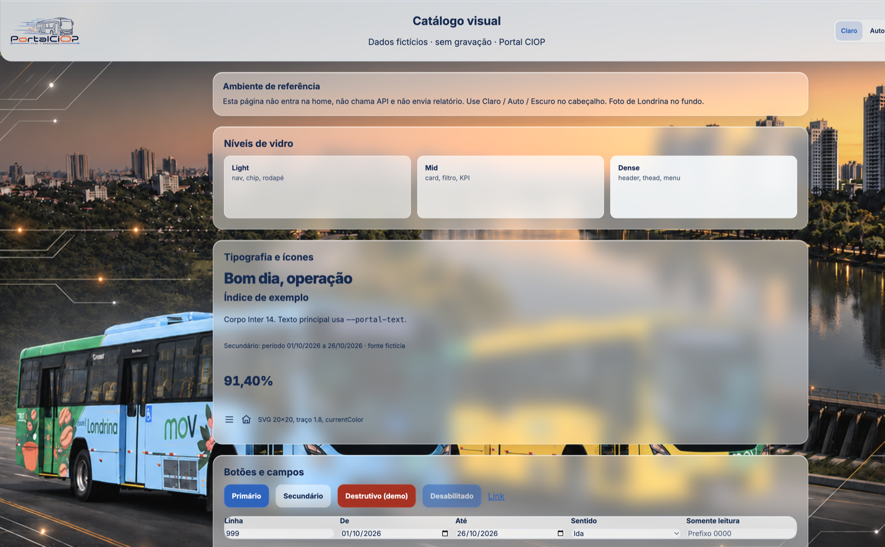
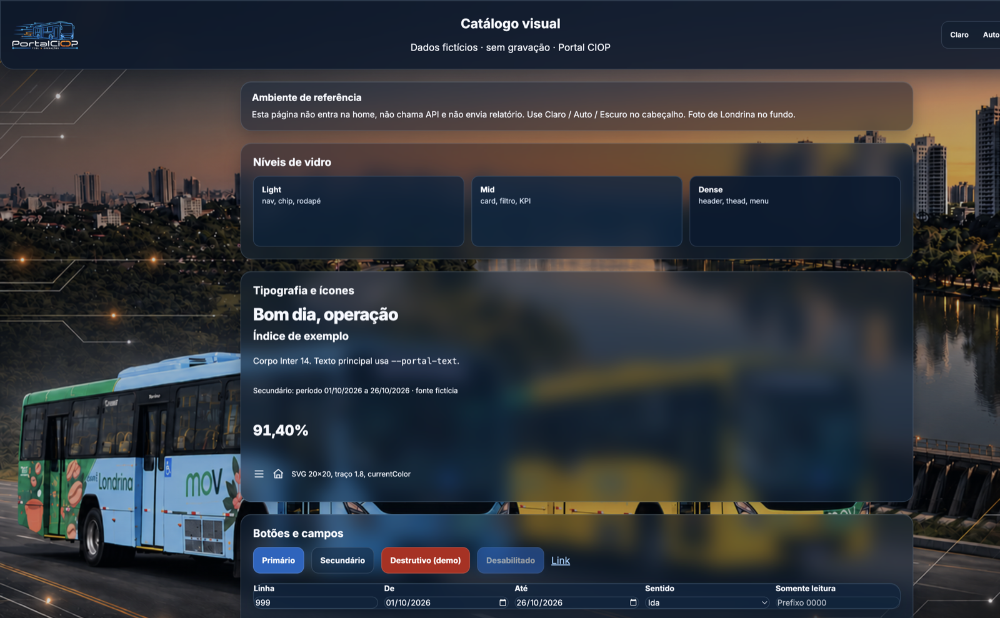
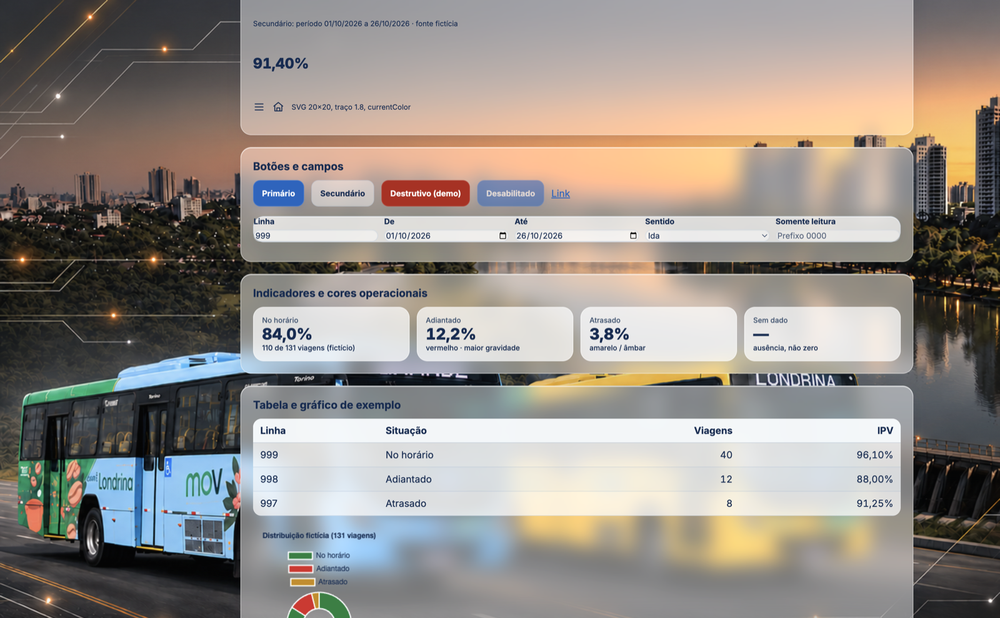
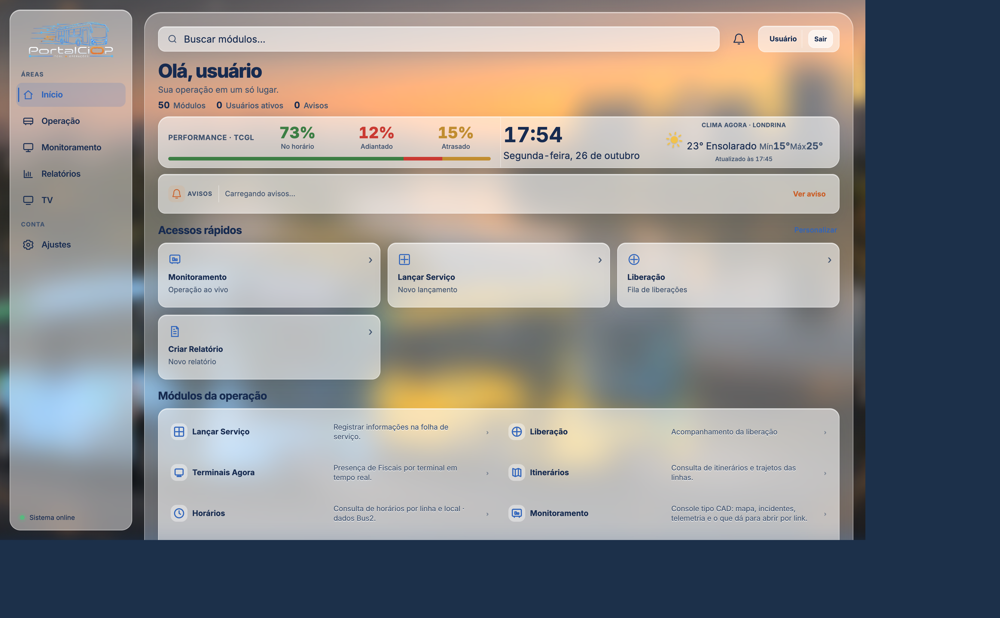
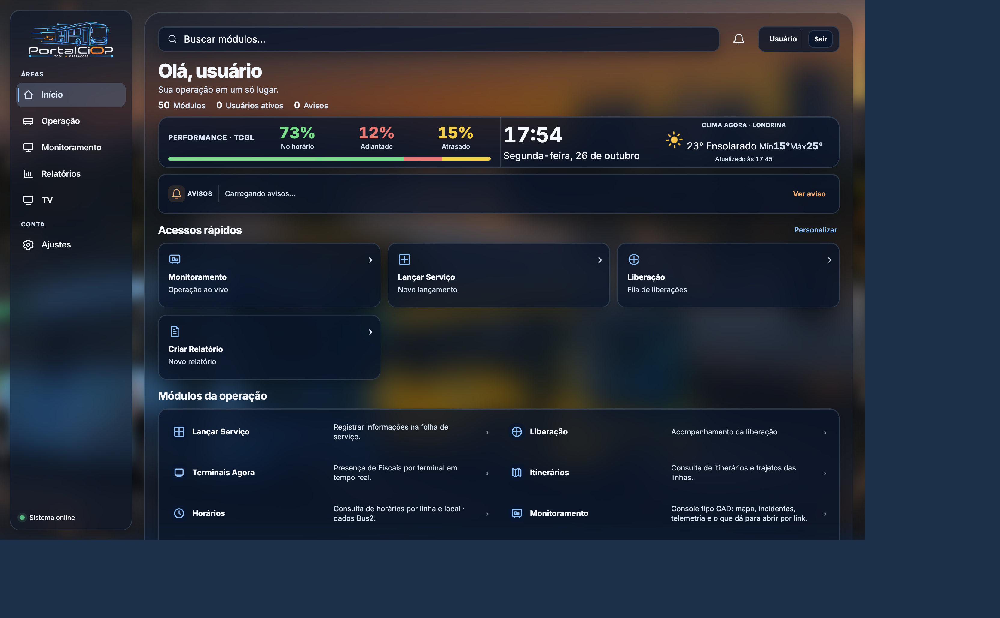
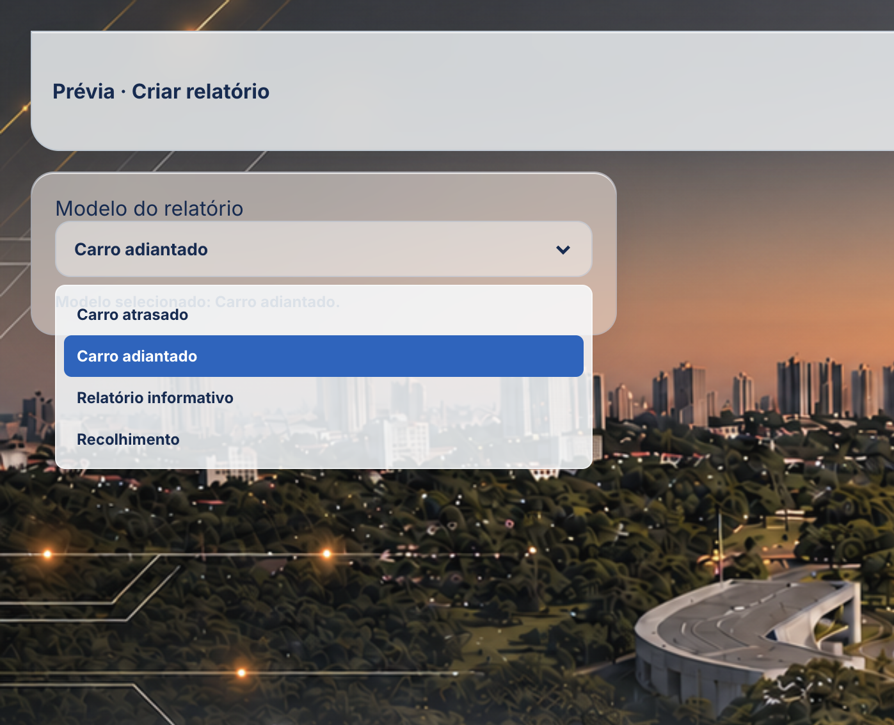
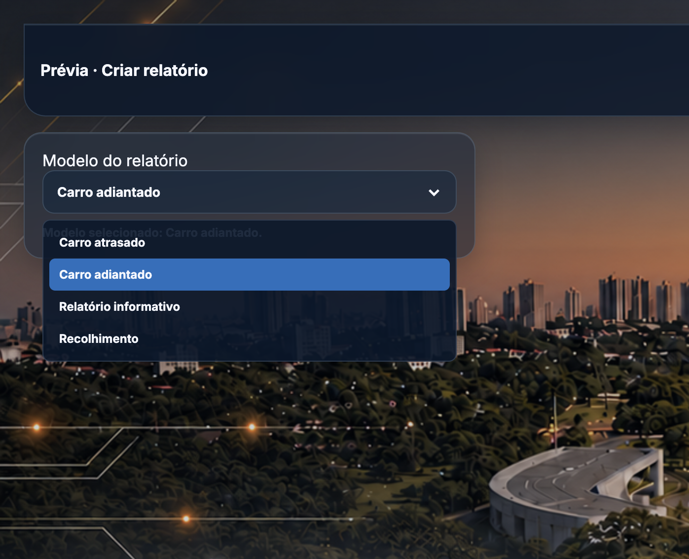
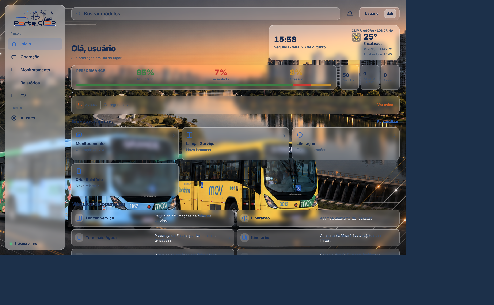

# Padrão visual e de interface — Portal CIOP

Referência oficial para **manter** e **criar** páginas no portal clássico (`index.html`, `login.html`, `pages/*.html`). Documenta o que está no código após a modernização Liquid Glass (outubro de 2026).

O `portal-app/` (React) e os kiosks de TV **não** copiam este chrome. TV mantém composição 16:9 para leitura à distância; o app nativo tem shell próprio.

## Objetivo e identidade

O Portal CIOP é o ambiente interno da TCGL Operações (Londrina): indicadores, mapas, liberações, folha, telemetria, autuações e consultas. A interface deve parecer o **mesmo produto** em qualquer módulo — logo CIOP/TCGL, fotografia da cidade, Inter, vidro sobre a foto, temas claro / escuro / automático.

Não redesenhar a marca. Não inventar KPI, fórmula ou paleta por página.

## Princípios

1. **Clareza operacional** — número, período, fonte e estado (carregando / vazio / erro) legíveis em segundos.
2. **Consistência** — tokens e classes compartilhadas; a página só descreve o layout do módulo.
3. **Acessibilidade** — contraste AA, foco visível, alvo ≥ 44 px, rótulos, `prefers-reduced-motion`.
4. **Desempenho** — vidro com blur controlado; tabelas com rolagem própria; mapas sem filtro invertido.
5. **Estética Liquid Glass** — transparência, profundidade e brilho discretos sobre a foto, sem esconder ônibus, rio ou skyline.

## Como consultar

| Precisa de | Documento |
| --- | --- |
| Logo, foto, tipo, ícones, escala | [identidade-visual.md](identidade-visual.md) |
| Temas e tabela de tokens | [temas-e-tokens.md](temas-e-tokens.md) |
| Vidro, blur, fallback | [liquid-glass.md](liquid-glass.md) |
| Cabeçalho, botões, tabelas, estados | [componentes.md](componentes.md) |
| Adiantado vermelho, Atrasado âmbar | [cores-operacionais.md](cores-operacionais.md) |
| Home, dashboard, formulário, TV | [layouts-e-responsividade.md](layouts-e-responsividade.md) |
| Textos, datas, zero vs. “—” | [conteudo-e-formatacao.md](conteudo-e-formatacao.md) |
| Contraste, teclado, blur | [acessibilidade-e-desempenho.md](acessibilidade-e-desempenho.md) |
| Página nova, passo a passo | [guia-novas-paginas.md](guia-novas-paginas.md) |
| Matriz de testes e pendências | [validacao.md](validacao.md) |
| Onde editar sem quebrar o resto | [manutencao.md](manutencao.md) |
| Exemplos clicáveis (dados fictícios) | [catalogo.html](catalogo.html) |
| Capturas de demonstração | [assets/](assets/) |

Histórico antigo de chrome: [`docs/interface/`](../interface/README.md) agora aponta para cá. Fases (`docs/fase-6-interface.md` etc.) são memória de projeto, não a fonte vigente.

## Demonstração (dados fictícios)

Tema claro e tema escuro no catálogo. Linha 999, prefixo 0000 — nada operacional.

Cores operacionais no claro (Adiantado vermelho, Atrasado âmbar, ausência como “—”):

Home (painel unificado de performance + hora + clima):

Seletor de modelo (criar relatório): filhos herdam a cor do botão; opção ativa azul com texto claro.

Widget de hora e clima (observação atual Open-Meteo, não a previsão no lugar do “agora”):

## Como criar uma página no padrão

1. Ler [guia-novas-paginas.md](guia-novas-paginas.md).
2. Copiar o HTML mínimo dali (boot de tema no `<head>`, `theme-toggle.js`, `img.portal-brand-art`, classes de botão).
3. Usar `var(--portal-*)` — nunca hex de texto “só claro”.
4. Ligar o módulo na home com `data-modulo` / `data-perfis` se for o caso.
5. Validar claro, escuro e 390 / 768 / 1366 / 1920 **sem** gravar dados reais.
6. Atualizar este padrão se o código compartilhado mudar.

## Arquivos-fonte (código)

- Tokens: `assets/css/portal-tokens.css`
- Chrome das páginas: `assets/js/portal-design-system.js` + `assets/css/portal-design-system.css`
- Tema: `assets/js/theme-toggle.js`
- Home: `assets/css/portal-home-2026.css` (pula o design system das internas)
- Auth / overlay / voltar Portal: `assets/js/auth.js`
- ICV extra: `assets/css/portal-liquid-icv.css`

## Implementado vs. pendência

**Implementado:** tokens, três temas, foto visível e **suavizada** na home, vidro light/mid/dense, painel `.home-sheet` translúcido, picker Claro/Auto/Escuro, cores operacionais nos tokens, fallback sem `backdrop-filter`, reduced motion no token de duração, overlay de login, rodapé `portal-footer.js`. Home: widget hora/data/clima à direita da saudação, sidebar 204 px, catálogo em linhas no painel, barra de performance, Adiantado vermelho / Atrasado âmbar.

**Pendências (não tratar como padrão pronto):** rota `GET /cr0108/ipv-ajustado`; flash de tema em páginas que só injetam `theme-toggle.js` depois do `auth.js`; botão sol/lua em `gerenciapatio.html`; catálogo e várias telas internas ainda não validadas com sessão. Detalhe em [validacao.md](validacao.md).
