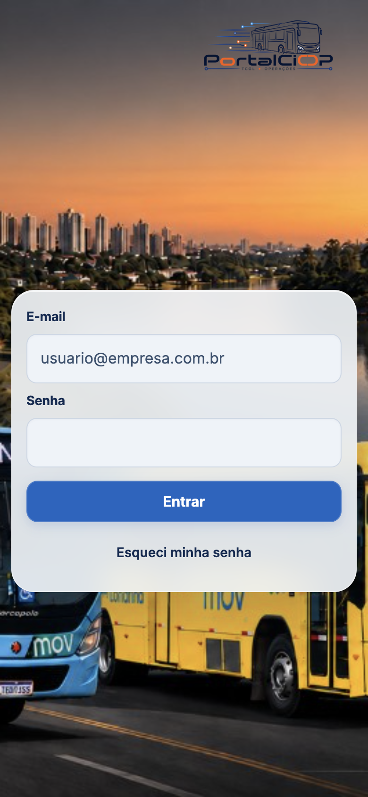

# Login

Página: `login.html`. Estilos: `assets/css/portal-login-v2.css` e o bloco de login em `assets/css/portal-design-system.css` (esse arquivo entra depois, via `portal-design-system.js`, e é o que chega na tela). Tema antes da pintura: `assets/js/theme-toggle.js` no `<head>`, sem `defer`.

O app React (`/app/login`) só entra com `?app=1` ou `?novo=1`. O login clássico é o desta página.

## Causa do texto branco sobre fundo branco

Dois estilos se somavam no tema escuro:

1. `login.html` e `portal-login-v2.css` forçavam `color-scheme: light` mesmo com `html.dk-dark`. O navegador pintava a superfície do formulário como clara.
2. O design system, mais específico e com `!important`, deixava o vidro em `rgba(255,255,255,.18)` e o campo em `rgba(255,255,255,.08)` a `.18`, enquanto a tinta seguia `--portal-text` / `--portal-on-field` (`#f5f8ff`).

Contraste medido antes da correção, no tema escuro: cerca de 1,06:1 no rótulo e no campo. O preenchimento automático do Chrome/Edge/Safari repetia o mesmo par (tinta clara sobre o fundo claro do autofill).

## Pares usados agora

| Peça | Superfície | Texto |
| --- | --- | --- |
| Página | foto + `--portal-fallback` | `--portal-text` |
| Vidro do cartão | `color-mix` de 92% de `--portal-fallback` | `--portal-text` |
| Sem `backdrop-filter` | `--portal-fallback` opaco | `--portal-text` |
| Campo, inclusive autofill | `--portal-fallback` | `--portal-on-field` e o mesmo no cursor |
| Placeholder | o fundo do campo | `--portal-text-secondary` |
| Entrar, hover e carregando | `#1265c2` (hover `#0b4ea0`) | `#fff` |
| Esqueci minha senha | transparente | `--portal-text` |
| Erro | `--portal-chip-missing-bg` | `--portal-chip-missing-fg` |
| Foco | anel de 3 px `--portal-focus` | — |

`!important` fica só nas regras que precisam vencer a folha do navegador (autofill) ou o design system que já usava `!important` no login. Não há tinta branca global.

O modo automático continua pelo sol de Londrina, não por `prefers-color-scheme`. Sem preferência salva, a página grava `auto`. O `color-scheme` do campo acompanha o tema resolvido, para o controle nativo não voltar ao esquema do sistema por baixo da tinta.

## Contraste medido (30/10/2026)

Texto normal, pior caso do vidro composto sobre foto branca ou preta.

| Peça | Claro | Escuro |
| --- | --- | --- |
| Rótulo sobre foto branca | 12,59:1 | 11,54:1 |
| Rótulo sobre foto preta | 10,45:1 | 15,14:1 |
| Campo | 12,48:1 | 14,61:1 |
| Placeholder | 7,18:1 | 11,93:1 |
| Botão Entrar | 5,73:1 | 5,73:1 |
| Erro | 6,68:1 | 8,51:1 |

Foco visível: 3 px `#1265c2` no claro e `#82c4ff` no escuro. Carregando mantém o azul, texto branco, `cursor: wait` e o rótulo “Entrando…”. Autofill (pseudo forçado): sombra interna de `--portal-fallback` e `-webkit-text-fill-color` igual a `--portal-on-field`.

Em 390×844 não há rolagem horizontal. O logo fica no canto, o cartão abaixo, sem cobrir campos nem a mensagem.

## WhatsApp Web

O login não tem atalho de WhatsApp. O ícone fica na tela inicial, na mesma linha da saudação, depois do nome. Só o ícone, sem o texto “Abrir WhatsApp Web”.

- Destino fixo: `https://web.whatsapp.com/`
- `target="_blank"` e `rel="noopener noreferrer"`
- Nome acessível: “Abrir WhatsApp Web”
- Não lê e-mail, senha nem qualquer campo
- Não é suporte e não leva número de telefone

## O que permanece

Logo `portal-ciop-claro.png` / `portal-ciop-escuro.png`, foto `portal-bg-onibus.jpg`, vidro, `signInWithEmailAndPassword`, persistência de sessão do navegador, 2FA, `sendPasswordResetEmail` e o retorno para `index.html`.

## Capturas

Sem e-mail, senha ou outro dado pessoal. O aviso da terceira imagem é o texto real quando a recuperação é pedida sem e-mail.

As capturas `login-whatsapp-claro-20261030.png` e `login-whatsapp-escuro-20261030.png` mostram o atalho que ficou no login e depois saiu de lá.

## Verificação desta rodada

Chrome (navegador Chromium do Cursor), em `http://127.0.0.1:8768/login.html`: vazio, foco, erro real da recuperação sem e-mail, carregamento desabilitado, autofill forçado, tema claro, tema escuro, automático sem preferência salva, e `prefers-color-scheme` claro e escuro sem mudar o tema resolvido pelo sol.

Edge e Firefox não estão instalados. Safari está instalado e não foi conduzido nesta rodada.

O ícone fica na saudação da tela inicial.
