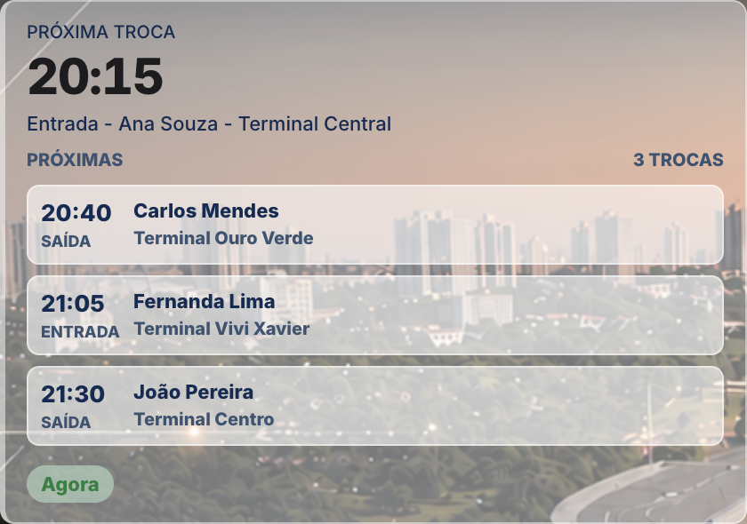
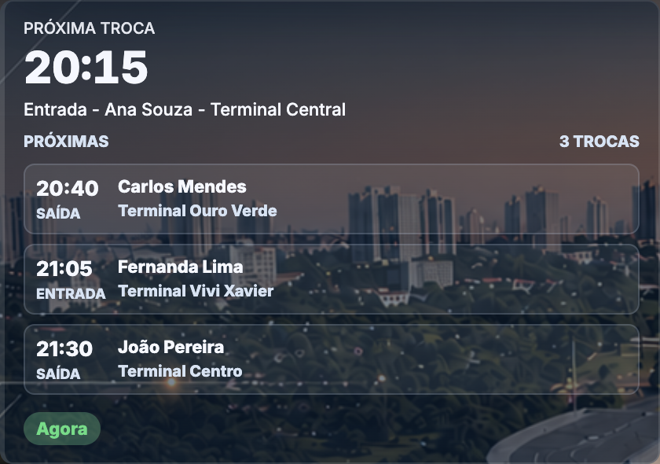

# Temas e tokens

Fonte de verdade: `assets/css/portal-tokens.css`. Não inventar hex paralelo.

## Três modos

| Preferência | Classe resolvida | Comportamento |
| --- | --- | --- |
| `light` | `html.dk-light` | Sempre claro |
| `dark` | `html.dk-dark` | Sempre escuro (navy fumê) |
| `auto` (padrão) | `dk-light` ou `dk-dark` | Claro de dia e escuro à noite em Londrina (`America/Sao_Paulo`, nascer/pôr do sol) |

Atributos: `data-dk-pref` (o que o usuário escolheu) e `data-dk-resolved` (`light` ou `dark`).

API: `window.dkSetPref('light'|'dark'|'auto')`, `window.dkIsDark()`. Evento: `dk-theme-change` com `{ detail: { dark, pref } }`.

Picker: `.dk-theme-opt[data-dk-pref]` (Claro / Auto / Escuro), `aria-pressed`. Na home fica na sidebar; nas internas o design system injeta em `.header-actions`.

## Persistência

1. Chave global: `localStorage['dk-theme']`.
2. Depois do login, chave por e-mail: `dk-theme:` + e-mail (`dkPreferenceKey` em `theme-toggle.js`). Lê a chave do usuário; se vazia, cai na global.
3. Valor inválido vira `auto`.
4. `auto` usa o nascer/pôr do sol em Londrina (`theme-toggle.js`), reagenda a troca e reaplica em `visibilitychange`. Não segue o tema do sistema.

A preferência **sobrevive** à navegação entre páginas e ao recarregar (validado no login e no Painel TV).

## Sem flash (FOUC)

O arquivo `theme-toggle.js` começa com `dkEarlyBoot()`: lê `dk-theme` e aplica `dk-light`/`dk-dark` **antes** do CSS da página, **se o script estiver no `<head>`**.

A home e o ICV repetem o mesmo boot inline no primeiro script do HTML (defesa extra).

Internas autenticadas passam a ter `theme-toggle.js` no `<head>` (sem `defer`), antes de `auth.js`. O Auto continua a usar o sol de Londrina (`dkPreferDarkBySun`). `auth.js` ainda chama `garantirThemeToggle()` se o script faltar. Kiosks de TV mantêm o script com `defer` (fundo próprio, tema da interface não pinta o palco).

## Tabela de tokens (valores reais)

Aliases legado (`--texto`, `--muted`, `--lg-*`, `--surface`…) apontam para os tokens abaixo. Preferir `--portal-*` em código novo.

### Pares superfície / conteúdo

Usar o token da **escrita** da superfície, não uma cor global de “texto branco”.

| Par | Superfície | Conteúdo |
| --- | --- | --- |
| Página / painel | `--portal-glass-mid` / `--portal-glass-dense` | `--portal-on-surface` (= `--portal-text`) |
| Card elevado | `--portal-glass-mid` | `--portal-on-elevated` |
| Campo | `--portal-field` | `--portal-on-field` |
| Campo do login | `--portal-fallback` (opaco) | `--portal-on-field` |
| Tooltip | `--portal-tooltip` | `--portal-on-tooltip` (`#f5f8ff` nos dois temas) |
| Seleção | `--portal-selection` | `--portal-on-selection` |
| Status operacional | — | `--portal-op-ontime` / `--early` / `--late` (não o texto do painel) |
| Desabilitado | campo com `--portal-glass-light` | `--portal-on-disabled` / `--portal-text-disabled` (sem `opacity` no bloco inteiro) |
| Carregando | painel | `--portal-state-loading` (classe `.portal-state-loading`) |
| Vazio | painel | `--portal-state-empty` (`.portal-state-empty`, “—” ) |
| Indisponível | painel | `--portal-state-unavailable` (`.portal-state-unavailable`, `.is-unavailable`) |
| Dado histórico | painel | `--portal-state-historic` (`.portal-state-historic`, `.is-stale`) |
| Documento / PDF | `--portal-paper` `#fff` | `#102c53` (mesmo no tema escuro da interface) |

No login, `--portal-field` no tema escuro é um véu branco de 8% e não segura texto claro. Os campos usam `--portal-fallback` opaco. Detalhe em [login.md](login.md).

### Selos de estado (`.portal-chip`)

Texto, fundo e borda andam juntos. A classe fica fora da regra que pinta `span` de painel em `portal-visual.css`, para o tema escuro não colocar texto claro em cima de um fundo claro. Contraste medido acima de 4,5:1 nos dois temas.

| Estado | Classe | Claro (texto / fundo) | Escuro (texto / fundo) |
| --- | --- | --- | --- |
| Sem registro | `.portal-chip-missing` | `#9f1239` / `#ffe4e6` | `#fecdd3` / `#5c2430` |
| Parcial | `.portal-chip-partial` | `#92400e` / `#fef3c7` | `#fde68a` / `#5a3a0c` |
| Aviso | `.portal-chip-warn` | `#9a3412` / `#ffedd5` | `#ffedd5` / `#5c2e0a` |
| Ok | `.portal-chip-ok` | `#065f46` / `#d1fae5` | `#bbf7d0` / `#064e3b` |
| Maior km | `.portal-chip-max` | `#166534` / `#dcfce7` | `#bbf7d0` / `#14532d` |
| Menor km | `.portal-chip-min` | `#0e7490` / `#cffafe` | `#a5f3fc` / `#164e63` |

Tokens: `--portal-chip-{missing|partial|warn|ok|max|min}-{fg|bg|bd}` em `assets/css/portal-tokens.css`. A borda usa o sufixo `bd`.

`--azul` e `--portal-fill-brand` servem a **preenchimento** de marca (botão, thead navy). Não usar `--azul` como cor de KPI no escuro.

### Seletor de modelo (`.modelo-btn` / `.modelo-item`)

Os filhos (`span`, SVG) usam `color: inherit` e `fill: currentColor`. Não pintar `span` de painel com hex fixo — isso foi a origem do navy/branco invertido.

| Estado | Fundo | Texto |
| --- | --- | --- |
| Botão fechado | `--portal-field` | `--portal-on-field` (filhos herdam) |
| Menu | `--portal-menu` | `--portal-on-option` |
| Opção | `--portal-option` (transparente) | `--portal-on-option` |
| Hover / foco | `--portal-option-hover` | `--portal-on-option` |
| Selecionada | `--portal-option-selected` (azul) | `--portal-on-option-selected` (claro) |
| Desabilitada | — | `--portal-text-disabled` |
| Mensagem “Modelo selecionado” | painel | `--portal-text-secondary` |

No escuro a seleção é azul com texto claro — nunca mint `#effcfb` com texto `--portal-text`. Prévia `.paper` permanece branca com `#102c53`.

Páginas internas: o design system remapeia `--text` / `--muted` / `--ink` para esses pares. `.kpi .value`, `.kpi-value`, `.bar-label`, `.terminal-name` e equivalentes herdam `--portal-on-elevated` **e** `-webkit-text-fill-color` igual à `color` (o fill sozinho deixava o número escuro no tema escuro). Exceções: `.paper`, `.report-sheet`, `.pdf-sheet`.

### KPI, seletor 2/6–1/3 e célula destacada

| Superfície | Fundo | Texto / fill |
| --- | --- | --- |
| `.kpi-value` | painel | `--portal-on-elevated` (clip `border-box`, sem mistura) |
| Adiantado (`.is-early`, `#kpiAdiantado`) | painel | `--portal-op-early` |
| Atrasado (`.is-late`, `#kpiAtrasado`) | painel | `--portal-op-late` |
| `.scenario-toggle` | `--portal-field` | — |
| `.scenario-button` inativo | transparente | `--portal-on-option` |
| `.scenario-button.active` | marca / azul | `#fff` |
| `.highlight-cell` | mistura de `--portal-op-ontime` | `--portal-op-ontime` (nunca mint `#f2faf4` com texto claro) |

### Linhas operacionais (próximas trocas, fiscais, chips)

Não deixar a linha branca se o tema escuro já pintou o nome de claro. Cada filho tem o par da superfície — não basta o contêiner.

| Superfície | Fundo | Texto / fill |
| --- | --- | --- |
| `.exchange-card`, `.terminal-card`, `.fiscal-lead-card` | `--portal-glass-mid` | `--portal-on-elevated` |
| `.exchange-item` | `--portal-field` | `--portal-on-field` |
| Nome / horário (`.exchange-person`, `.exchange-time`) | linha | `--portal-on-elevated` |
| Terminal / tipo / registro / atualização | linha | `--portal-text-secondary`, 12–13 px, peso 500 |
| Hover / foco da linha | `--portal-option-hover` | `--portal-on-option` |
| `.time-chip`, `.terminal-kpi-time`, `.count-pill` | `--portal-field` | `--portal-on-field` |
| `.status-badge.status-now` | mistura de `--portal-op-ontime` | `--portal-op-ontime` |
| `.status-badge.status-next` / reserva | mistura de `--portal-accent-warn` | `--portal-accent-warn` |
| `.segmented button` inativo | transparente sobre `--portal-field` | `--portal-on-option` |
| `.segmented button.active` | `--portal-option-selected` | `--portal-on-option-selected` |
| `.error-box` | mistura de `--portal-op-early` | `--portal-op-early` |
| `.paper` / PDF | `--portal-paper` | `#102c53` (não herda o texto claro do tema) |

`.terminal-kpi-card` no escuro usa mistura do acento do terminal com `--portal-glass-mid`, não o degradê até `#fff`.






### Texto e ação

| Token | Finalidade | Claro | Escuro |
| --- | --- | --- | --- |
| `--portal-text` | Texto principal | `#102c53` | `#f5f8ff` |
| `--portal-text-secondary` | Descrição, cargo, muted | `#3a5270` | `#d5e3f4` |
| `--portal-text-aux` | Apoio | `#4a6180` | `#b7c9de` |
| `--portal-text-disabled` | Desabilitado | `#7a8aa0` | `#8aa0b8` |
| `--portal-accent` | Ação / foco de marca | `#1265c2` | `#82c4ff` |
| `--portal-accent-warn` | Aviso (não é Atrasado) | `#d95508` | `#ffab66` |
| `--portal-focus` | Anel de foco | `#1265c2` | `#82c4ff` |
| `--portal-selection` | Seleção de texto | `rgba(18, 101, 194, 0.2)` | `rgba(130, 196, 255, 0.22)` |

### Status operacional (ver [cores-operacionais.md](cores-operacionais.md))

| Token | Significado | Claro | Escuro |
| --- | --- | --- | --- |
| `--portal-op-ontime` | No horário | `#15803d` | `#4ade80` |
| `--portal-op-early` | Adiantado (maior gravidade) | `#dc2626` | `#f87171` |
| `--portal-op-late` | Atrasado | `#ca8a04` | `#facc15` |

### Vidro, campos, bordas

| Token | Finalidade | Claro | Escuro |
| --- | --- | --- | --- |
| `--portal-glass-light` | Nav, rodapé, chip | `rgba(255,255,255,.22)` | `rgba(8,26,46,.28)` |
| `--portal-glass-mid` | Card, filtro, KPI | `rgba(255,255,255,.46)` | `rgba(12,36,62,.52)` |
| `--portal-glass-dense` | Header, menu, sidebar | `rgba(248,252,255,.78)` | `rgba(8,24,44,.82)` |
| `--portal-field` | Input / select | `rgba(255,255,255,.58)` | `rgba(255,255,255,.08)` |
| `--portal-menu` | Menu denso | `rgba(248,252,255,.84)` | `rgba(8,24,44,.90)` |
| `--portal-table` | Tabela / gráfico | `rgba(255,255,255,.72)` | `rgba(8,26,46,.78)` |
| `--portal-modal` | Dialog | `rgba(248,252,255,.82)` | `rgba(8,24,44,.88)` |
| `--portal-tooltip` | Tooltip | `rgba(12,32,54,.94)` | `rgba(6,16,30,.94)` |
| `--portal-border` | Borda de vidro | `rgba(255,255,255,.5)` | `rgba(191,219,246,.18)` |
| `--portal-border-strong` | Borda com tinta | `rgba(18,70,130,.16)` | `rgba(179,212,243,.22)` |
| `--portal-fallback` | Sem backdrop-filter | `#eef3f8` | `#10253c` |
| `--portal-paper` | Papel de documento | `#fff` | `#fff` (prévia permanece branca) |
| `--portal-photo-veil` | Véu sobre a foto | ver arquivo | ver arquivo |

Blur: `--portal-blur-light` `blur(10px) saturate(140%)`; mid 16 px / 150%; dense 22 px / 160%.

Espaço, raio, duração: [identidade-visual.md](identidade-visual.md).

## Gráficos e componentes

Padrão **implementado no ICV:** `icvChartTheme()` lê `html.dk-dark` e pinta eixos/grade; `dk-theme-change` chama `renderChart` de novo. **Dados não mudam.**

```javascript
function icvChartTheme() {
  const dark = document.documentElement.classList.contains("dk-dark");
  return {
    tick: dark ? "#d5e3f4" : "#3a5270",
    grid: dark ? "rgba(179,212,243,.16)" : "rgba(16,44,83,.12)",
    title: dark ? "#f5f8ff" : "#102c53",
    duration: matchMedia("(prefers-reduced-motion: reduce)").matches ? 0 : 200
  };
}
window.addEventListener("dk-theme-change", () => {
  if (lastChartVisual) renderChart(lastChartVisual);
});
```

Nem todo Chart.js do repositório escuta o evento. Página nova com gráfico **deve** escutar. Cores das séries operacionais (adiantado/atrasado) usam os tokens `--portal-op-*`, não o azul de eixo.

## Uso

```css
.kpi-value { color: var(--portal-text); font-variant-numeric: tabular-nums; }
.kpi-sub { color: var(--portal-text-secondary); }
.panel {
  background: var(--portal-glass-mid);
  border: 1px solid var(--portal-border);
  border-radius: var(--portal-radius-lg);
  box-shadow: var(--portal-shadow-mid);
  backdrop-filter: var(--portal-blur-mid);
}
```

## Eliminar cores fixas indevidas

1. Procurar hex de texto (`#06245c`, `#344054`, `#64748b`, `#94a3b8`, `#101828`) em CSS da página.
2. Trocar por `var(--portal-text)` / `--portal-text-secondary`.
3. Conferir `-webkit-text-fill-color` igual a `color` (Safari).
4. Não “corrigir” uma tela com hex solto se o token resolve várias páginas — editar `portal-tokens.css` ou o design system.

Exceção legítima: kiosk TV (`pages/painel-tv.html` e afins) tem paleta própria de alto contraste; documento em [cores-operacionais.md](cores-operacionais.md).
